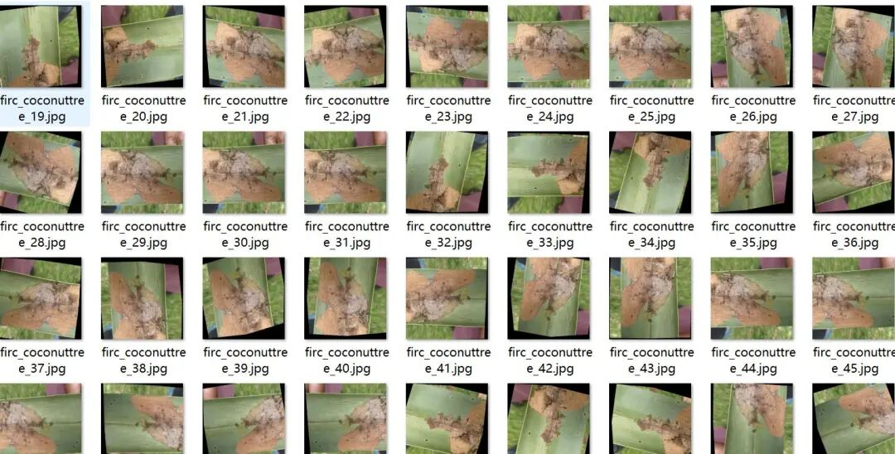
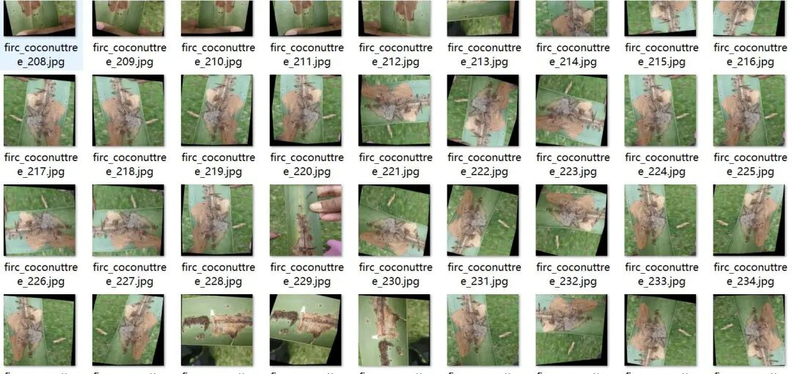
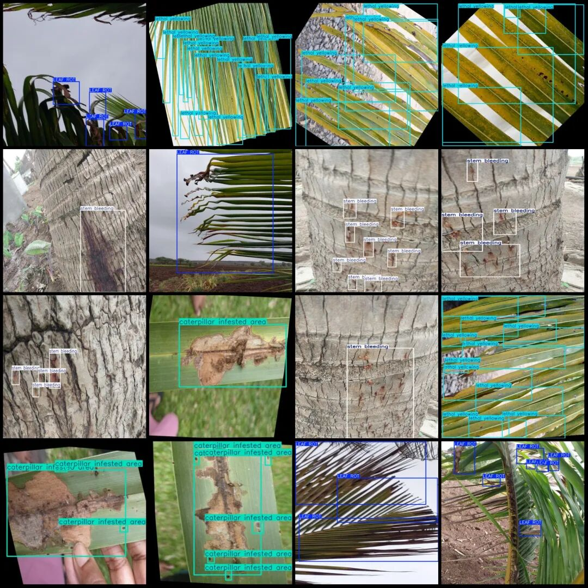
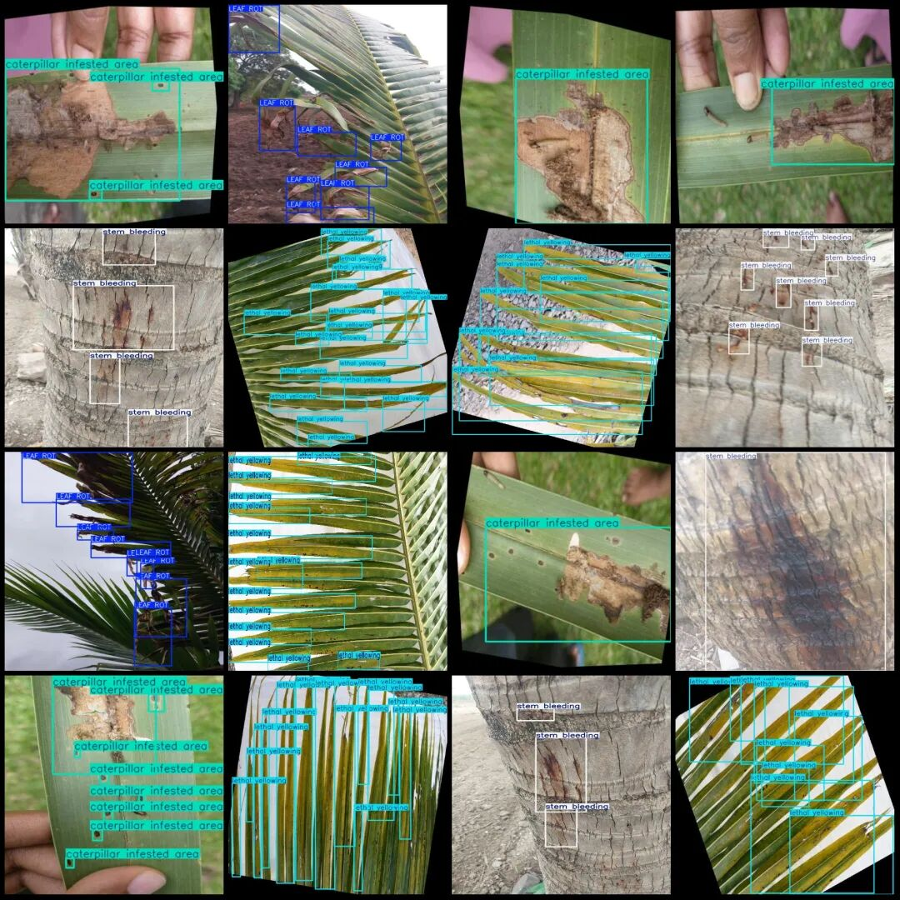

# Coconut Tree Disease Detection Dataset VOC+YOLO format with 2601 images in 4 categories

Please note that the dataset contains a large number of enhanced images, primarily rotation enhancements. Please carefully review the images.

Dataset format: Pascal VOC format + YOLO format (txt file without split path, only contains jpg images and corresponding VOC format xml files and yolo format txt files)

Number of images (number of jpg files): 2601

Number of annotations (number of xml files): 2601

Number of annotations (number of txt files): 2601

Label category count: 4

Label category names (note that the order of categories in the YOLO format does not correspond to this, but is based on the labels folder's classes.txt): ["LEAF ROT", "caterpillar infested area", "lethal yellowing", "stem bleeding"]

Number of boxes labeled in each category:

LEAF ROT (Leaf Rot) Frames = 2804

caterpillar infested area (Areas affected by caterpillar infestation) Frame count = 3164

Lethal Yellowing (lethal yellowing) frame count = 5673

Stem bleeding (stem blistering) frame count = 2847

Total frame count: 14488

Image resolution: Multi-resolution images, such as 416x416, 640x640, etc.

Using labelImg:

Annotation rules: Draw a rectangle around the category.

Important Notice: The dataset does not have separate training, validation, and test sets; you need to partition them yourself.

Special : This dataset does not guarantee the accuracy of the trained models or weight files.

Image Preview:

Annotation example:

## Payment

Here is a pay link on Stripe ( https://buy.stripe.com/3cs8yP7sY87d0vu9AB ). Please contact me lonlonago@foxmail.com after funding $89, and I will send you a complete data files , thank you!

